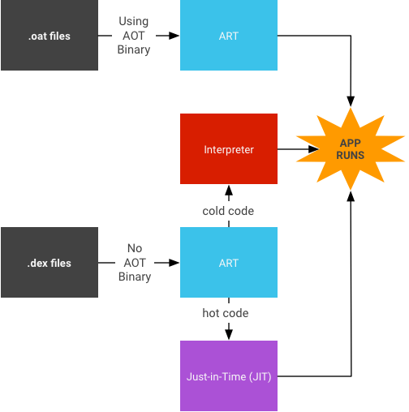

# Overview

본 글에선 Android의 Runtime인 ART(Android Runtime)와 Dalvik VM에 대해 설명한다.  

# Dalvik VM

Android에선 하나의 앱이 실행되면 Zygote Process에서 fork 하여 새 Process를 생성한다.  
Dalvik VM은 새 Process에 할당되며, 해당 Process에서 DEX bytecode를 실행한다.  
또한 Android 2.2부터 Dalvik에 JIT(Just-In-Time) 컴파일러가 도입되어 성능이 향상되었다.  

여기서 DEX bytecode란, Android의 Runtime용 bytecode이다.  
보통 앱은 Java나 Kotlin을 통해 만들어 진다.  
하지만 Java와 Kotlin 코드 그 자체를 실행시킬 수는 없기에 컴파일하는 과정에서 Dalvik VM이 실행할 수 있는 DEX(Dalvik Executable)라는 bytecode로 만들어진다.  

즉, Dalvik VM은 우리가 앱을 만들기 위해 작성하는 Java와 Kotlin 코드를 실행하는 역할을 한다.  
단, .so 같은 네이티브 라이브러리들은 Dalvik VM이 아닌 CPU가 실행한다.  

# ART(Android Runtime)

ART(Android Runtime)은 Dalvik VM의 상위 버전이라고 생각하면 된다.  
Dalvik VM은 Android 5.0 이전까지만 사용이 되었고, 이후인 Android 5.0부터는 ART로 바뀌었다.  

그렇다면 왜 Dalvik VM에서 ART로 바뀌었을까?  
이유는 앱 실행 최적화 방식 전체를 개선하기 위해서이다.  

기존에 Dalvik VM은 JIT 중심의 최적화를 진행했다.  
이러한 방식에는 실행하는 코드만 컴파일 한다는 점에서 메모리를 절약할 수 있다는 장점이 있지만, 실행 중에 컴파일을 한다는 점에서 런타임 오버헤드가 발생할 수 있다.  

하지만 ART에서는 AOT(Ahead-Of-Time)을 사용하며 이러한 단점을 극복하였다.  
JIT는 실행 중에 컴파일이 되지만, AOT는 앱을 설치하는 시점에 컴파일을 진행한다.  
여기서 dex2oat Daemon이 DEX bytecode를 oat라고 부르는 파일로 변환하여 저장한다.  
때문에 실행 시간이 빠르다는 장점이 있고, 설치할 때 컴파일 하다 보니 설치가 느리다는 단점도 갖고 있다.  

그러면 이 두 컴파일러의 장점만 합친 것은 없을까?  
당연히 있다.  
Android 7.0에서 AOT에 JIT가 추가되게 된다.  
대체 어떻게 AOT랑 JIT를 같이 사용하는 걸까?  

앞에서 설명한 것을 통해 AOT 보다 JIT가 설치 시간이 더 빠르다는 것은 알고 있을 것이다.  
이러한 이점을 사용하여 설치 시에는 JIT를 사용하여 빠르게 설치한다.  
그 후, 앱을 실행할 때 ART가 .dex 파일을 로드한다.  
이때 만약 .oat 파일이 존재한다면 AOT로 해당 .oat 파일을 사용하고, 없다면 JIT와 Interpreter를 함께 사용하여 .dex 파일을 로드한다.  
JIT는 Profile Data를 덤프하고, 유휴 상태거나 백그라운드에서 dex2oat Daemon이 해당 Profile을 읽고, AOT 컴파일을 유도한다.  
여기서 말하는 Profile Data는 ART가 앱을 실행하며 어떤 메서드/클래스가 많이 쓰였는지 등을 기록해 둔 데이터다.  

즉, 설치/업데이트 때는 최적화 부담을 줄여 빠르게 끝내고, 실행 중 수집된 Profile을 바탕으로 기기가 유휴일 때 자주 쓰는 코드만 선별적으로 AOT 컴파일해 성능을 끌어올린다.  

# References

- https://ekyoo.tistory.com/m/entry/%EB%8B%AC%EB%B9%85-%EA%B0%80%EC%83%81%EB%A8%B8%EC%8B%A0%EC%9D%B4%EB%9E%80
- https://source.android.com/docs/core/runtime?hl=ko
- https://android-developers.googleblog.com/2010/05/dalvik-jit.html
- https://gyeongwons.tistory.com/91
- https://mangkyu.tistory.com/343
- https://thinking-face.tistory.com/218
- https://source.android.com/docs/core/runtime/jit-compiler?hl=ko