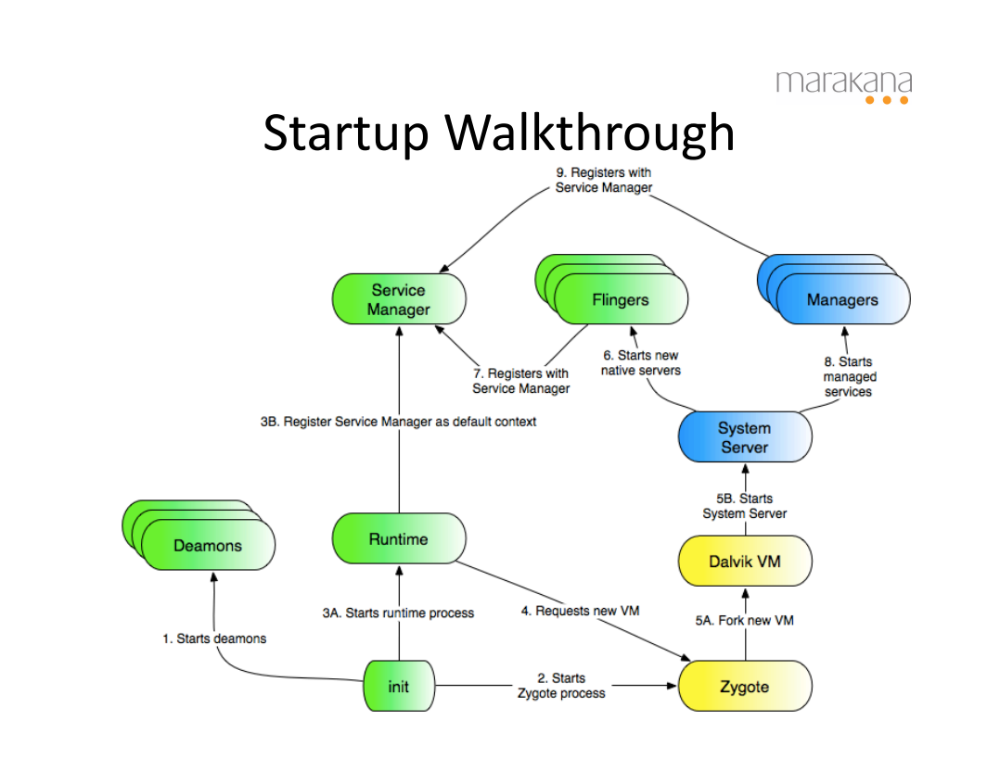

# Overview

본 글은 Android가 부팅된 후, 어떠한 초기화 과정을 거치는지 설명하기 위해 작성되었다.  
우선 들어가기에 앞서, Android Runtime Walkthrough에 대한 여러 자료를 찾아본 결과 다들 설명하는 내용들이 조금씩 달랐기에 Marakana의 자료를 중점으로 작성하였다.  

# Runtime Flow

Android는 linux 기반으로 구성되어 있기에, 가장 먼저 bootloader가 linux kernel를 로드한다.  
그 후, init이 실행되는데, 이 init 후부터 글마다 설명하는 흐름이 조금씩 다르기에 정확하게 알고싶으신 분은 따로 찾아보시는게 좋을 것 같다.  

가장 먼저 init이 Daemon Process들을 실행 시킨다.  
여기서 Daemon은 주로 init에서 띄우는 logd나 netd, lmkd 같은 System Service용 Background Process들이다.  

그 다음으로 Zygote Process가 실행되는데, 얘는 Process Template이라고 생각하면 편하다.  
Android에서는 새로운 Process를 만들 때마다 처음부터 Process를 구성하는 것 대신, 미리 자주 쓰는 클래스/리소스를 preload 해 둔 Zygote를 fork 하여 만든다.  
그래서 속도가 빠르기도 하고, Android에서 돌아가는 모든 Process의 부모가 Zygote이다.  

그럼 이제 마지막으로 init에서 실행 시키는 Runtime이 남았다.  
여기서 말하는 Runtime은 거의 ART(Android Runtime)을 의미하는데, 이는 다음 글에서 설명하도록 하겠다.  

Marakana의 walkthrough 사진에선 Runtime이 Service Manager를 실행 시킨다고 표현되어 있다.  
이 Service Manager는 Application이 System Service를 찾는 걸 도와주는 작업을 한다.  
Service Manager가 실행되면 Dalvik VM이 실행되어야 하는데, 이 Dalvik VM을 실행하는 방법들이 각 글마다 다 다르다.  

Dalvik VM이 뭔지 간단하게 설명하자면, Android에선 Java를 사용하는데, Java를 구동하기 위해선 JVM(Java Virtual Machine)이 필요하다.  
이 JVM을 Android 구조에 맞춰 만든 것이 바로 Dalvik VM이다.  

Dalvik VM까지 구동되면 이제 System Server라는 애가 실행된다.  
Android에는 Framework Service라고 부르는 시스템의 핵심 기능을 수행하는 중요한 구성 요소들이 있다.  
대표적으로 AMS(ActivityManagerService), PMS(PackageManagerService), WMS(WindowManagerService) 같은 구성 요소가 들어있다.  

System Server는 이 Framework Service를 관리하는 역할을 한다.  
즉, System Server는 Android에서 돌아가는 다른 Process가 특정 요청을 보내면 그에 맞는 Service가 처리하도록 도와주는 역할을 한다.  
추가로 System Server는 Zygote Process가 가장 처음으로 fork 하는 Process이다.  

그럼 이제 System Server까지 실행이 됐다.  
하지만 이것들만 가지고 Android가 실행이 될까?  
당연히 안된다.  

위에 있는 Marakana walkthrough 사진을 보면 System Server가 실행된 후, Flingers와 Managers라는 애로 두 화살표가 뻗어있다.  
여기서 Managers는 아까 설명한 Framework Service들을 뜻하므로 넘어가고, Flinger를 설명하도록 하겠다.  

우선 Flingers의 의미를 구글에 쳐보면 아마 SurfaceFlinger, AudioFlinger 같은 것들만 뜰 것이다.  
여기서 말하는 SurfaceFlinger랑 AudioFlinger는 Flinger의 대표적인 예이다.  

우선 SurfaceFlinger랑 AudioFlinger가 뭔 작업을 하는지 간단하게 설명하겠다.  
SurfaceFlinger는 Application이나 System이 만든 여러 화면 버퍼를 받은 후, 이를 어떻게 잘 처리해서 디스플레이로 보낸다.  
AutioFlinger도 Application이나 System한테 받은 Audio Stream을 모아서 처리한 후, Audio 관련 Hardware에 보낸다.
즉, 특정 버퍼들을 모은 후, 이를 처리하여 한 번에 던져주는 작업을 진행한다고 보면 된다.  

근데 이제 Flinger들을 실행만 하면 다른 Process들이 어떻게 사용해야 할지 모를게 뻔하다.  
때문에 Service Manager에 등록하여 다른 Process들이 사용할 수 있도록 해주면 Android의 부팅 흐름이 완료된다.  

# References

- https://www.csa.iisc.ac.in/~gopi/os09/Marakana-Android-Internals.pdf
- https://moving-coding.tistory.com/27
- https://coding-by-head.tistory.com/entry/daemon-android
- https://develoid.github.io/android/android-runtime.html
- https://m.blog.naver.com/er65119/222021688049
- https://gomguk.tistory.com/210
- https://www.flowdas.com/introduction-to-android-binder/service-manager/index.html
- https://coding-by-head.tistory.com/entry/uc-framework-service
- https://csjung.tistory.com/162
- https://stackoverflow.com/questions/6926551/android-usage-of-the-flinger-term
- https://jung-max.github.io/2020/01/16/Android-Surfaceflinger/