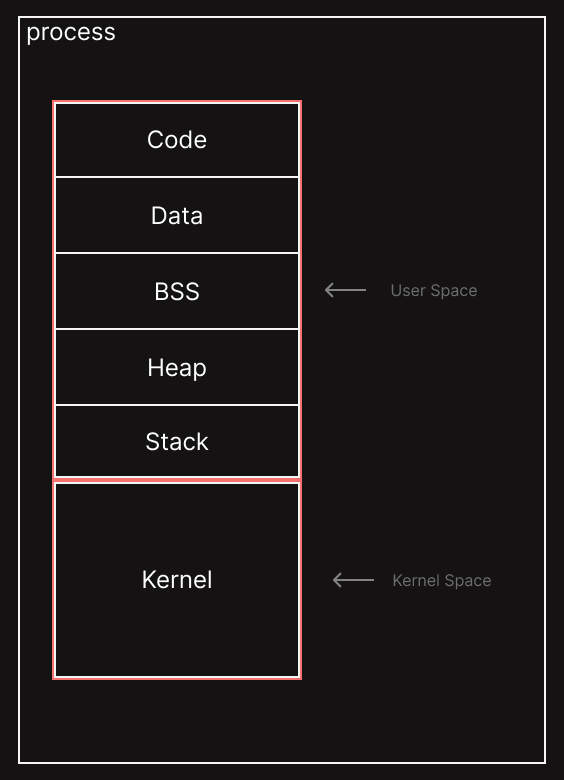
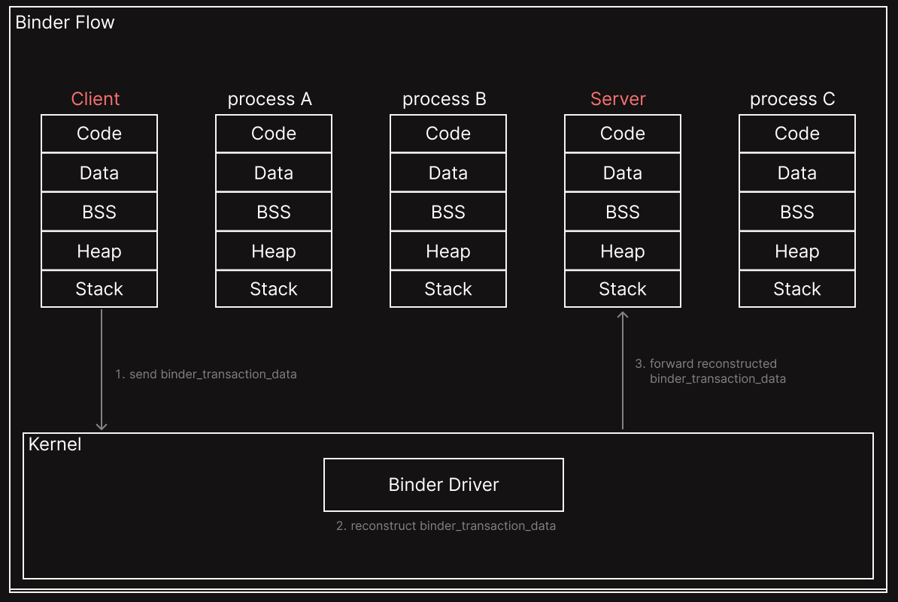

# Overview

본 글은 Android의 프로세스 간 통신 방법인 Binder에 대해 다룬다.  

# What is Binder?

Binder는 Android에서 프로세스 간에 데이터를 주고받거나 메서드를 호출하는 등의 통신을 할 수 있게 해주는 메커니즘이다. 

여기서 프로세스끼리 데이터를 주고받는 일 전체를 가리키는 것을 IPC라 하고, 다른 프로세스의 메서드를 호출하는 걸 RPC라 한다.  
즉, RPC는 IPC의 한 종류이고, Android에서는 Binder가 둘을 이어주는 느낌이다.  

그럼 이제 Binder가 어떻게 동작하는지 알아보자.  

# How Binder Works

바로 Binder의 동작 과정을 설명하기 전에 Android 프로세스 메모리 공간에 대해 알아보자.  
다들 알다시피 Android는 Linux를 기반으로 만들어졌다. 때문에 프로세스는 자신만의 가상 주소 공간을 갖고 있다.  

위와 같이 구성이 되어 있는데, 여기서 사용자 공간은 다른 프로세스와 공유가 안된다. 하지만 커널 공간이 다른 프로세스와 공유가 되기 때문에 이 커널 공간을 통해 다른 프로세스와 통신하게 된다.  

그럼 데이터 혹은 메서드 호출을 특정 프로세스에게 어떻게 보낼까?  
분명 우리 컴퓨터에는 여러 프로세스들이 돌아가고 있고, 그만큼 여러 프로세스들과 커널 공간을 공유하고 있을 것이다. 그래서 어떤 프로세스에게 어떤 메서드를 보낼지 같은 정보를 담는 binder_transaction_data 구조를 사용한다.  

여기서 용어 하나 정리하고 넘어가자면, 메서드를 호출하는 프로세스가 클라이언트이고, 해당 메서드를 갖고 있는 프로세스가 서버다.  
즉, 클라이언트가 binder_transaction_data에 정보를 담아서 커널 공간에 있는 Binder Driver한테 넘겨준다.  
그러면 Binder Driver는 해당 정보로 Server를 찾아서 Server 기준으로 정보를 재구성하여 전달해준다.  

대략 위와 같은 식으로 진행된다.  
이를 통해 Android Binder의 통신 과정을 간단하게 살펴봤다.  
아직 자세한 binder_transaction_data 구조 및 Binder Driver가 재구성하는 binder_transasction_data 등 안 쓴 부분 많기에 이는 나중에 다루도록 하겠다.  

# References
- https://jtm0609.tistory.com/297
- https://source.android.com/docs/core/architecture/ipc/binder-overview?hl=ko
- https://www.synacktiv.com/publications/binder-transactions-in-the-bowels-of-the-linux-kernel