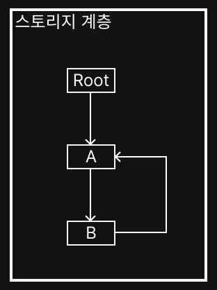

# Overview

이번에 KUality 동아리에서 미션을 도입하였는데, "오픈소스 소프트웨어 취약점 분석"이란 미션이 있어서 한 번 진행해 봤다.  
미션 목표는 실제로 사용되고 있는 오픈소스 소프트웨어 혹은 라이브러리를 대상으로 취약점 분석을 진행하는 것이었고, 산출물은 기술 보고서 혹은 블로그 글이기에 본 글을 작성하게 됐다.  

먼저 어떤 취약점을 찾았는지 간단하게 설명하자면, OpenMcdf라는 라이브러리에서 발생하는 스택 소진 DoS 취약점으로, CVSS 6.2를 받았다.  
그럼 이제 해당 취약점에 대해 자세하게 알아보자.  

# What is OpenMcdf?

[OpenMcdf](https://github.com/openmcdf/openmcdf)는 흔히 OLE라 불리는 MS-CFB 포맷을 읽고 쓰는 오픈소스 .NET 라이브러리이다.  
MS-CFB가 뭔지 간략하게 설명하자면, 하나의 바이너리 파일 안에 여러 개의 storage(디렉터리)와 stream(파일)을 계층 구조로 담을 수 있는 파일 형식이다.  
이러한 OpenMcdf 라이브러리를 사용하는 프로그램의 수는 매우 많고, 특히 쓰는 작업 보다 읽고 분석하는 프로그램의 비율이 더 높다.  
때문에 OpenMcdf 라이브러리의 파일을 읽고 처리하는 부분을 중점으로 확인했다.  

# Attack Surface

먼저 공격 표면을 좁히기 위해 다음 세 부분을 먼저 봤다.  

1. 공격자가 작성한 MS-CFB 파일을 통해 OpenMcdf의 구조를 통제할 수 있는가?  
2. 해당 구조를 코드가 순회하는가?  
3. 순회 처리 경로에 종료 보장이 있는가?

## 공격자가 작성한 MS-CFB 파일을 통해 OpenMcdf의 구조를 통제할 수 있는가?  

CFB의 디렉터리는 단순 배열이 아닌 포인터로 연결된 트리 구조를 갖는다.  
각 128바이트 디렉터리 엔트리는 다음 두 종류의 ID를 갖는다.  

- LeftSiblingId / RightSiblingId → 같은 부모 아래 형제들을 묶는 red-black BST
- ChildId → 해당 스토리지가 품는 자식 트리의 루트 (계층 형성)

여기서 중요한 점은, 이 ID들이 전부 디렉터리 엔트리 배열의 인덱스고, 파일 바이트를 수정하면 임의의 값으로 바꿀 수 있다.  

게다가 한 CFB 파일 안에는 서로 독립적인 구조가 여러 겹 쌓여 있다.  

- FAT 섹터 체인: 일반 스트림 데이터의 섹터 연결 리스트
- MiniFAT 섹터 체인: 작은 스트림의 미니 섹터 연결 리스트
- 형제 트리: LeftSiblingId/RightSiblingId로 묶이는 red-black BST (한 레벨 내)
- 스토리지 계층: ChildId로 레벨을 내려가는 트리

그러다보니 총 포인터 공간은 네 개가 되고, 순환/공유 같은 걸 막는 방어도 네 개 모두 각각 따로 적용되어 있어야 한다.  

## 해당 구조를 코드가 순회하는가?  

git log를 보면 순환 입력을 오래전부터 고치려고 했던 것을 확인할 수 있다.  

|ID|설명|종류|
|---|---|---|
|de52b97|cyclic fat structure 보호|FAT 체인|
|27775bd|GetMiniSectorChain 순환 체크|MiniFAT 체인|
|c5ed58e|Detect FAT cycles with Floyd's|FAT 체인|
|9efa549|MiniFAT cycles (Floyd)|MiniFAT 체인|
|eb184b9|MiniFAT cycles (Brent)|MiniFAT 체인|
|646e95e|Brent's algorithm|섹터 체인|
|33b8419|cyclic reference in siblings|형제 트리|
|24f445a|Detect directory tree cycles (Brent)|형제 트리|

즉 네 개의 구조 중 세 개(FAT, MiniFAT, 형제 트리)에는 순환 방어가 쌓여 있다.  
하지만 남은 스토리지 계층에 대한 순환 방어는 유독 비어있었고, 재귀로 내려가는 코드가 세 개나 있었다.  

## 순회 처리 경로에 종료 보장이 있는가?

순환 처리를 진행할 때, 세 개의 트리 구조에는 각각 종료 보장이 존재했다.  

- FAT 체인 → Brent 알고리즘으로 사이클 검증
- MiniFAT 체인 → Brent 알고리즘
- 형제 트리 → BST 엄격 정렬 검증이 재방문/공유 노드를 검출

하지만 스토리지 계층에는 방문 집합이나 깊이 제한 둘 다 존재하지 않았다.  
또한, OpenMcdf의 디렉터리 검증은 DirectoryTreeEnumerator가 담당하는데, 이는 스토리지가 한 레벨마다 새로 생성된다.  

```cs
// DirectoryTreeEnumerator.cs - rootId는 한 스토리지의 자식 트리 루트
internal DirectoryTreeEnumerator(RootContextSite rootContextSite, uint rootId) {...}

public bool MoveNext() 
{
    ...
    // (a) 형제 BST가 이름 오름차순인지
    ThrowHelper.ThrowIfInvalidBinarySearchTree(compare <= 0);
    // (b) 형제 간 순환은 sibling validator가 검출
    DirectoryEntry? rightSibling = Directories.TryGetSibling(current, SiblingType.Right, validator);
    ...
}
```

검증이 보는 것은 형제 트리의 정렬과 형제 트리 내부의 순환뿐이었다.  
ChildId로 레벨을 가로지르는 간선을 추적하는 전역 방문 집합은 없었고, DirectoryTreeEnumerator는 레벨마다 리셋되므로 ChildId의 간선을 추적하는 데에는 적합하지 않았다.  

# Vulnerability

따라서 다음 구조를 살펴보자.    



- A 레벨 형제 트리: 노드 1개 → 정상 → 통과
- B 레벨 형제 트리: 노드 1개 → 정상 → 통과

각 레벨이 완벽히 유효하기 때문에, MS-CFB 명세상 순환 디렉터리 참조는 명백한 손상이지만 예외가 나지 않는다.  

취약점은 파일이 멀쩡하게 열린 뒤, 프로그램이 복사•삭제•flush를 하는 순간 터지게 된다.  

```cs
public void CopyTo(Storage destination)
{
    ...
    foreach (DirectoryEntry entry in EnumerateDirectoryEntries())   // 현재 레벨의 자식들
        Copy(entry, destination);
}
```

```cs
private void Copy(DirectoryEntry entry, Storage destination) 
{
    if (entry.Type is StorageType.Storage)
    {
        Storage subSource = new(ContextSite, entry, this);
        Storage subDestination = destination.CreateStorage(entry.NameString);
        subSource.CopyTo(subDestination);   // 레벨마다 재귀
    }
}
```

위 코드를 보면 다음 세 가지가 결여되어 있다.  

- 방문 기록 없음
- 깊이 제한 없음
- 콜스택 재귀

아까 위에 있던 사진처럼 A → B → A → B → ...를 왕복하게 되면 스택을 소진하게 되고, Delete 경로(DeleteEntry → TryDeleteFirstChildEntry → DeleteEntry → ...)와 consolidation flush 경로도 동일한 재귀를 탄다.  

취약점 트리거까지의 입력 처리 흐름은 다음과 같다.  

```text
[공격자] 1,536바이트 CFB 생성
		 Root → A → B 구성 후,
		 B 디렉터리 엔트리의 ChildId를 A의 ID로 덮어씀
			  │
			  ▼
[Open]  RootStorage.Open(stream, StrictValidation)
		  └─ 헤더/FAT/MiniFAT 검증 → 통과
		  └─ 디렉터리: 레벨별 형제 트리만 검증 → A, B 각각 정상 → 통과
			  │
			  ▼
[사용]  애플리케이션이 Storage.CopyTo(destination) 호출
			  │
			  ▼
[재귀]  CopyTo(Root)
			→ Copy(A) → A.CopyTo
			   → Copy(B) → B.CopyTo
				  → Copy(A) → A.CopyTo
					 → Copy(B) → B.CopyTo
						→ …  (A,B,A,B… 무한)
		  매 레벨마다: 소스 sub-Storage 생성 + destination에 CreateStorage + 재귀 → 스택 프레임 누적
			  │
			  ▼
[크래시] CLR 콜스택 소진 → StackOverflowException → 프로세스 종료
```

# Patch

이 취약점은 3.4.0 버전에서 수정됐고, 수정 방식은 크게 두 가지다.  

- CopyTo/Delete의 콜스택 재귀를 반복문 + 명시적 stack으로 교체
- 순회 중 방문한 스토리지 ID를 HashSet에 기록

# Conclusion

CFB의 디렉터리와 체인은 명세상 트리•체인이지만, 그 구조를 잇는 포인터가 전부 공격자 통제 하에 있으니 사실은 순환 참조가 섞일 수 있는 구조로 봐야 한다.  
기존 방어가 FAT•MiniFAT•형제 트리 세 곳에만 쌓여 있고 네 번째 공간이 비어 있다는 점도, 포인터 공간이 여러 개인 포맷에서는 모든 공간을 똑같이 의심해야 한다는 걸 보여준다.  

이번에 분석한 취약점의 원문은 [GHSA-gf88-675q-4hh9](https://github.com/openmcdf/openmcdf/security/advisories/GHSA-gf88-675q-4hh9)에서 찾아볼 수 있다.  